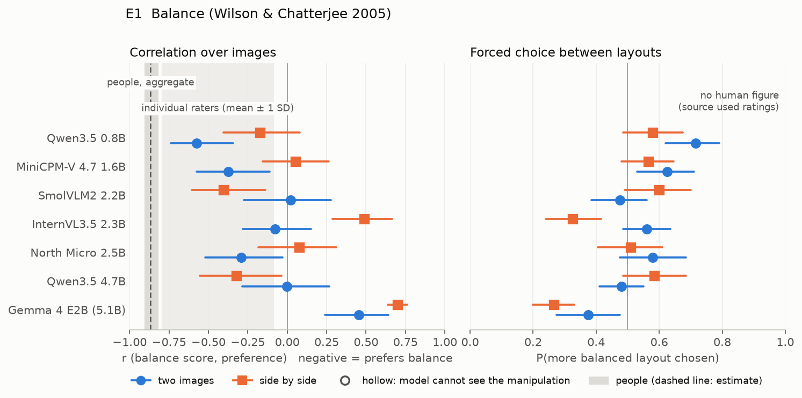
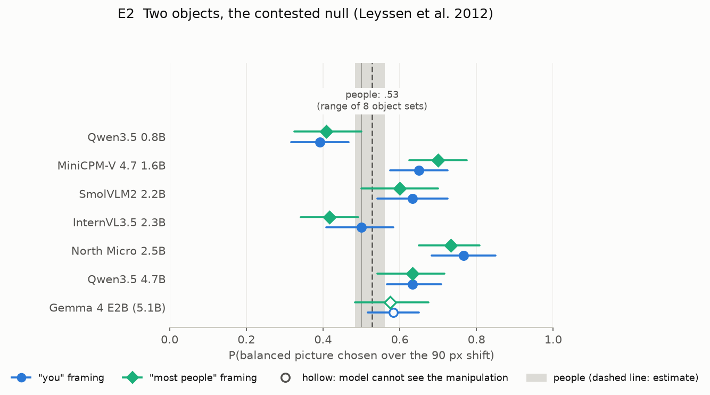
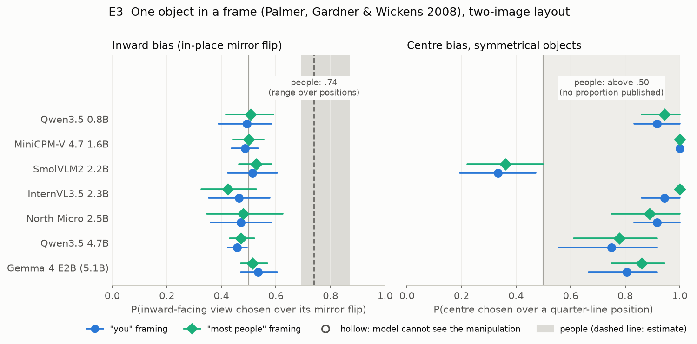
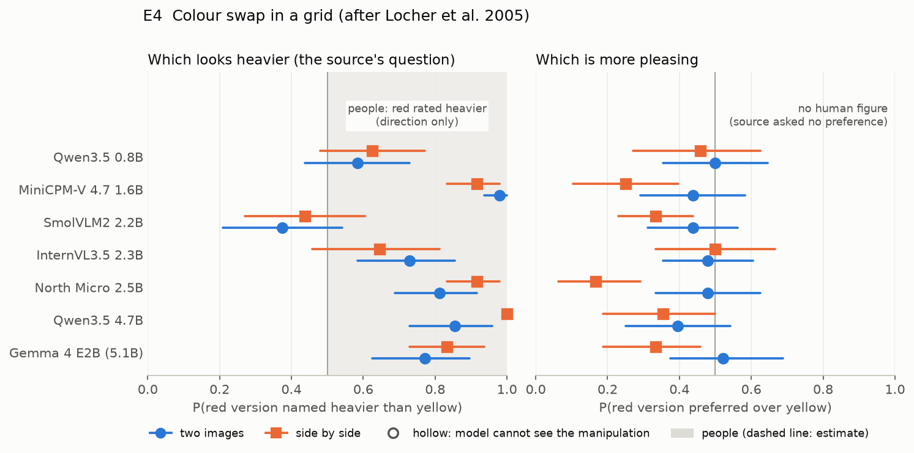
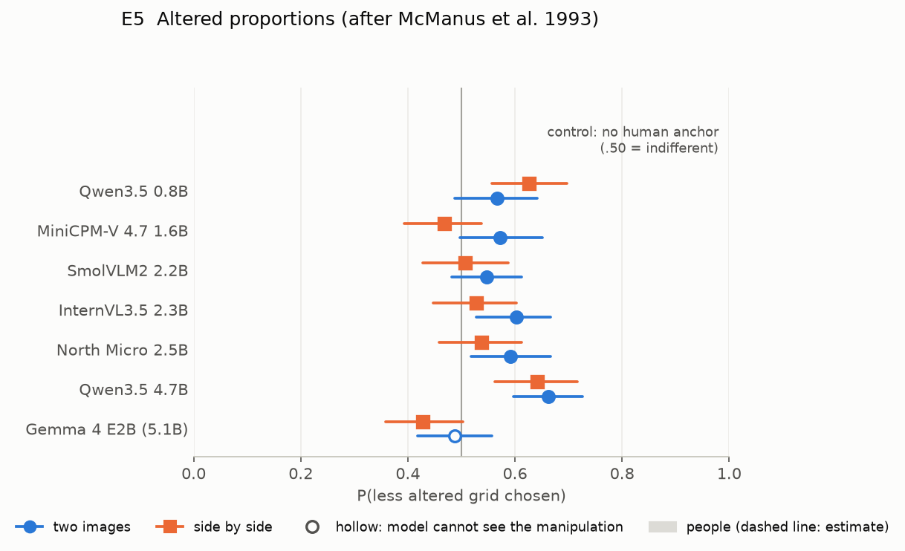
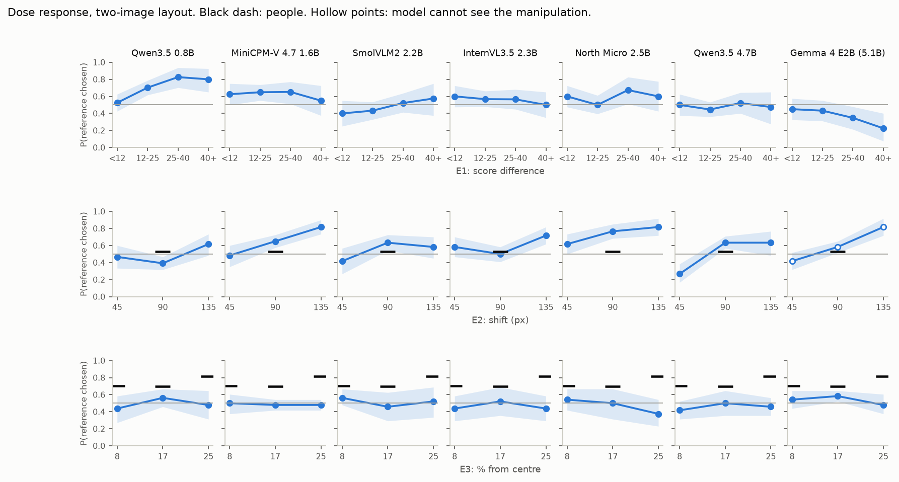

# Do vision-language models share people's compositional preferences?

**Status: approved by the owner at Gate 3, 2026-11-18.** Tier 2 (Claude models) was not run; it awaits the owner's confirmation of API credit.
- **Complete:** the main run and the wording check.
- **Written before the test results were opened:** the methods, the limitations and the
  prediction criteria.

## Findings

All figures here are from the two-image layout under the "you" framing, unless stated.
Each model is a single observer, and the intervals are 95% intervals over stimuli.

**1. The two textbook effects that are robust in people were not reproduced.**
- **Balance (E1).** People show it strongly in aggregate (r = −.85 to −.88 over images) and
  weakly as individuals (mean −.28 to −.46).
  - Three models lean the human way:
    - Qwen3.5-0.8B: r = −.58 [−.74, −.34];
    - MiniCPM-V: −.37;
    - North Micro: −.29.
  - Three are at zero.
  - Gemma 4 E2B prefers the *unbalanced* layouts: +.45 [+.24, +.64].
  - None is stronger than individual people (P6 not supported for any).
  - Qwen's correlation survives rewording: on the dev pairs it is −.69 to −.79 under all four
    wordings of the question.
  - No model shows it in both layouts. Side by side, the three that lean the human way
    lose it: Qwen falls to −.17 with an interval that includes zero, and MiniCPM-V and North
    Micro turn positive. Two that showed nothing with two images gain it side by side:
    SmolVLM2 (−.40) and Qwen3.5-4B (−.32).
- **Inward bias (E3).** People choose the inward-facing view of an object .74 of the time.
  Every model is at chance (.46 to .54), under both framings (P3 not supported for any).
  Rewording does not produce it either: of 28 model-and-wording cells on dev, one shows an
  inward preference (SmolVLM2 under "prefer", .67), and several lean outward.

**2. In the contested null (E2), half the models prefer balance more than people do.**
- People chose the balanced picture .53 of the time, not above chance.
- For three of the six models that can see the shift, the whole interval lies above the
  highest human value, .56 (P2 supported):
  - MiniCPM-V: .65 [.57, .72];
  - Qwen3.5-4B: .63 [.57, .71];
  - North Micro: .77 [.68, .85].
- The others:
  - SmolVLM2 is inconclusive at .63.
  - InternVL is at .50.
  - Qwen3.5-0.8B prefers the unbalanced picture: .39 [.32, .47].
- In all seven models the preference for the balanced picture is higher at a 135 px shift
  than at 45 px. At 45 px, Qwen3.5-4B prefers the shifted picture: .27.
- This is the direction the brief predicted, but in only half the models.
- **Only North Micro's result survives rewording.** It prefers the balanced picture under
  all four wordings on dev (.81 to .97). The rule set in advance marks the other two as
  wording-dependent:
  - MiniCPM-V's falls from .69 under the frozen wording to .41–.47 under the other three.
  - Qwen3.5-4B's stays between .62 and .69, but under "prefer" its interval reaches .50.

**3. Two simpler effects are reproduced by most models.**
- **Centre over quarter line** for symmetrical objects (E3): six of seven models, .75 to
  1.00. SmolVLM2 is reversed at .33.
- **Red named heavier than yellow** (E4, a weight judgement, not a preference): five of
  seven, .73 to .98.
- But neither shows the human pattern of size. People's colour effect appears at the
  smaller areas and vanishes at the largest. In the models it is as large or larger at the
  largest area: reversed in three, P4 not supported in any.

**4. What a model "prefers" is fragile, and often smaller than its biases.**
- **Position bias.** On identical pairs it reaches +3.4 log-odds with two images and −4.1 side
  by side (both Gemma 4). In six of the seven models it changes sign between layouts in at
  least one experiment.
  - Within an experiment, a small model's position bias exceeds its largest effect in 14 of
    20 model-and-experiment cells. This is a post-hoc reading; the pre-committed P1 test
    pooled biases of opposite sign, see below.
- **Forced answer against free answer.** On single trials the forced answer agrees with the
  model's own free-text answer from 51% (InternVL) to 90% (North Micro).
- **Off-menu answers.** Gemma 4 puts under half its probability on the two letters on 24% of
  E1 trials and 20% of E3 trials.
- **No refusals.** No model refuses: at most 8% of free replies decline to choose (Gemma 4).

**5. The smallest models could see every manipulation (P5 not supported).**
- Qwen3.5-0.8B and MiniCPM-V tell the subtlest changes from identical pairs with an AUC of
  .83 to .99.
- The model that cannot see E2's shift, at any size, is the largest: Gemma 4 E2B (AUC .65).
- So the failures above are failures of preference, not of perception.

### Predictions

| | Prediction | Result |
|---|---|---|
| P1 | Small models: position bias larger than any aesthetic effect | 2 of 5 as committed (SmolVLM2, North Micro); 14 of 20 experiment cells post hoc |
| P2 | E2: models prefer balance more than people | 3 of 6 testable supported, of which only North Micro survives rewording; 1 reversed; 2 inconclusive; Gemma cannot see |
| P3 | Mirror flips: stronger under "most people" | 0 of 7 |
| P4 | Effects grow with dose like people's | E1: 1 of 7 (Qwen3.5-0.8B; reversed in Gemma). E3: 0 of 7. E4: 0 of 7 (reversed in 3) |
| P5 | Smallest models fail on the subtlest manipulations | Not supported: both see them |
| P6 | E1 correlation stronger than individual people's | 0 of 7; best is Qwen3.5-0.8B, inconclusive |

Full tables are in `reports/predictions_test.md`, and the position-bias and visibility
checks are in `reports/checks_test.md`.

### Corrections made after the results were opened

Both are logged in `LOG.md`; neither changes a committed criterion.

1. **A bug in the scoring code.** It counted identical control pairs as part of E2's 90 px
   pairs and E3's mirror flips. These share a condition label in the manifest.
   - Fixing it changed three P4 (E3) verdicts from "reversed" to "not supported"
     (InternVL, Qwen3.5-4B, Gemma).
   - No other verdict changed.
2. **P1 as committed is flawed.** It averages the signed position bias over E1 to E4, so a
   bias toward the first image in one experiment cancels one toward the second in another.
   - The committed verdict is reported as it is.
   - A per-experiment comparison is shown beside it and labelled post hoc.

### Wording check (exploratory)

The seven models answered every dev pair of E1 to E3 under four wordings: "more pleasing to
look at" (the frozen one), "like more", "more beautiful" and "prefer". All tables are in
`reports/wording_check.md`. The design and rules were set in `PLAN.md` before the run.

**What survives a rewording** (the "you" framing; each model, experiment and wording is
classed consistent, null throughout, mixed or reversed):

| | Consistent across all four wordings | Null throughout | Mixed (wording-dependent) |
|---|---|---|---|
| E1 balance | Qwen3.5-0.8B (r −.69 to −.79); Gemma and InternVL, both *against* balance | MiniCPM-V, North Micro, SmolVLM2 | Qwen3.5-4B |
| E2 two objects | North Micro (.81 to .97) | Gemma, Qwen3.5-0.8B, SmolVLM2 | MiniCPM-V, InternVL, Qwen3.5-4B |
| E3 inward bias | none | Gemma, InternVL, Qwen3.5-4B | MiniCPM-V, North Micro, Qwen3.5-0.8B, SmolVLM2 (all near or below .50 except SmolVLM2 under "prefer") |

No cell is *reversed*: no model shows a clear effect in one direction under one wording and
the other direction under another. The wordings move effects in and out of significance;
they do not flip them.

**Other results:**
- **Pairs rank alike across wordings.** Pair-level preferences under each new wording
  correlate .70 to .98 with the frozen wording, in every model but one. That model is
  SmolVLM2: .0 to .4, because its preferences are tiny (spread 0.03 log-odds) and mostly
  noise.
- **Position bias moves with the wording too.** Gemma 4's E1 bias is +1.47, +0.15, +1.93 and
  −0.05 log-odds under the four wordings.
- **Repeatability.** All 7,392 pilot trials that the check repeated (1,056 per model) came
  out bit-identical, with a largest difference of 0.0000 log-odds. So the driver update
  between the pilot and the main run moved no score.

**Caveats.**
- Dev has 8 E1 families against 20 on test, so the dev intervals are wider.
- Dev and test can disagree. InternVL's E1 correlation is +.40 on dev against −.08 on test.
  MiniCPM-V's test lean toward balance (−.37) does not appear on dev under any wording.
  The wording check speaks to the wording, not to every number in the main run.

## One figure per experiment

Each figure shows the human figure as a grey band (dashed line: the estimate), and each
model's estimate with its 95% interval over stimuli. A hollow marker means the model fails
the visibility rule in that experiment.













Example pairs, with what people chose and what each model chose, are in
`reports/examples/index.html`.

---

## Methods

### Design in one paragraph

Five published experiments on picture composition were re-run on seven open-weight
vision-language models as two-alternative forced choices:
- **Stimuli:** each trial shows a code-generated composition and a controlled variant of it,
  and the model is asked which it finds more pleasing.
- **Counterbalancing:** each pair is shown four times: both orders crossed with both
  assignments of the answer letters.
- **Readout:** the model's choice is read from the log-probabilities of the two letters.
- **Score:** each model's effect, with an interval over stimuli, set beside the published
  human effect.

Predictions were written into `PLAN.md` first. The code, prompt and models were then frozen,
and the test stimuli were generated for the first time and run once.

### The five experiments

Full designs, human numbers and their provenance are in `docs/experiments.md`.

| | Source | What changes within a pair | Human anchor | Model statistic |
|---|---|---|---|---|
| E1 | Wilson & Chatterjee (2005), Assessment of Preference for Balance | Placement of seven black elements: five balance levels of the same elements | r(balance score, liking) = -.85 to -.88 over images. Individual raters average -.28 to -.46 (Hübner & Fillinger 2016) | r between balance score and preference scale value; P(more balanced chosen) by score difference |
| E2 | Leyssen et al. (2012), Exp. 5, two objects | The two-object group shifted 90 px off-centre | P(balanced chosen) about .53, not above chance (the contested null) | P(balanced chosen) at 90 px; also 45 and 135 px |
| E3 | Palmer, Gardner & Wickens (2008), one object | In-place mirror flip; shift of position | Inward-facing view chosen about .74; centre preferred | P(inward-facing chosen); centre against quarter line |
| E4 | Locher, Overbeeke & Stappers (2005), colour in grid compositions | Colours swapped between the largest area and a small one | Direction only: red rated heavier than yellow (a weight judgement, not preference) | P(red named heavier), asked as a weight question; preference asked too, no anchor |
| E5 | McManus, Cheema & Stoker (1993), proportions | Grid lines moved by a small or large amount | None for generated grids | P(less-altered chosen): a control |

E1 to E3 carry the human comparison. E4 and E5 are reduced forms approved at Gate 1:
- E4 keeps only the direction of a weight judgement.
- E5 has no human anchor. The source compares altered paintings with the artist's original,
  which the code-only rule excludes.

### Stimuli

Every image is drawn by code from a seed (`src/aesx/experiments/`); none reproduces an
artwork or a real design.
- **Dev and test:** separate random streams. In E3 the icon sets are separate too, so no
  test icon was seen during development.
- **Test split:** 1,307 changed pairs and 150 identical pairs.

| | Changed pairs | Identical pairs |
|---|---|---|
| E1 | 200 | 40 |
| E2 | 300 | 30 |
| E3 | 390 | 39 |
| E4 | 216 | 18 |
| E5 | 201 | 23 |

- **Generation and checks:** `scripts/make_stimuli.py`, which refuses to write the test
  split unless the code matches the freeze. Every image's SHA-256 is in its manifest.
- **E1 balance score:** reproduces the paper's printed value for its Figure 2 image (8.61
  against 8.58).

### Models

Seven Tier 1 models, all Apache-2.0, run locally in bfloat16. Each is pinned to a Hugging
Face commit (`src/aesx/models/registry.py`), and the commit actually loaded is recorded in
each run's `run.json`.

| Model | Parameters | Family |
|---|---|---|
| Qwen3.5-0.8B | 0.9B | Qwen (Alibaba) |
| MiniCPM-V 4.7 1B | 1.6B | MiniCPM-V (OpenBMB) |
| SmolVLM2-2.2B | 2.3B | SmolVLM (Hugging Face) |
| InternVL3.5-2B | 2.3B | InternVL (OpenGVLab) |
| North Micro Vision | 2.5B | North (Cohere) |
| Qwen3.5-4B | 4.7B | Qwen (Alibaba) |
| Gemma 4 E2B | 5.1B | Gemma (Google) |

Software: transformers 5.23.0, PyTorch 2.15.0 with CUDA 13.2, on one 16 GB RTX 4090 Laptop
GPU. Each model's default image preprocessing (resizing, tiling) is left as shipped. No
API model was run (Tier 2 waits on the owner confirming API credit).

### Presentation and prompt (frozen as `v1`)

**Two-image layout (primary).** The user turn is:
- "Image A:", then the first image;
- "Image B:", then the second image;
- the question, then "Answer with one letter only: A or B."

**Side-by-side arm (E1, E4, E5).** One picture holds both images, with a sentence saying
which side carries which letter.

**Questions.**
- "you" framing: "Which of these two images do you find more pleasing to look at?"
- "most people" framing: "Which of these two images would most people find more pleasing to
  look at?"
- E4 also asks: "In which of these two images does the largest coloured rectangle look
  visually heavier?"

**Trials.** Each pair is shown in both orders, crossed with both letter assignments, under
both framings. That gives 34,432 trials per model: 23,012 with two images and 11,420 in the
side-by-side arm.

### Readout

- **Single trials.** The model's reply is started with "Answer:", and the log-probabilities
  of the two permitted letters are read from the next token. Spellings with and without a
  leading space are summed.
- **A pair's preference** is the mean, over its four counterbalanced presentations, of the
  log-odds for the reference image. Position and letter biases cancel in this mean.
- **A pair's choice** is 1 if that mean is positive.
- **What is reported:** only these bias-cancelled pair-level numbers. Single trials are
  dominated by position and letter bias.

### Controls

- **Position bias.** Measured on identical pairs, where there is nothing to prefer: the
  log-odds of naming the first image.
- **Visibility.** On every pair the model is also asked "Are these two images exactly
  identical?" and "Is there any difference between these two images?", so that a yes-bias
  cancels. The area under the ROC curve then separates changed pairs from identical ones.
  - A model's preference in an experiment is reported only if this AUC is at least .75
    and the lower end of its interval is above .50.
  - Otherwise the model is listed as unable to see the manipulation.
- **Refusals.** A forced readout cannot refuse, so refusals are counted separately (the rule
  the owner approved at Gate 2).
  - Each model answers 60 test preference trials freely: no reply prefix, up to 160 tokens.
  - Each reply is classed as direct, commits, refuses or unclear.
  - A model refusing on more than a fifth would be reported as refusing, not scored.
  - The same sample gives how often the forced answer agrees with the model's unaided one.
- **Off-menu.** The share of trials on which the two letters hold under half of the
  next-token probability.
- **Dose response.** E1 by balance-score difference; E2 at 45, 90 and 135 px; E3 by distance
  from the centre; E4 by area.

### Statistics

- **Model intervals:** 95% bootstrap intervals over stimuli, 2,000 resamples. Pairs that
  share images are resampled together: a family in E1, a unit in E2, an icon in E3, a
  layout in E4 and E5.
- **Visibility AUC intervals:** resample pairs.
- **No significance test between a model and people.** The two intervals describe different
  things: variation over stimuli for one model, and variation over people where a paper
  reports it at all. So overlap is described, not tested.
- **Predictions P1 to P6:** scored by `scripts/predictions.py`, whose criteria were
  committed before the test results were opened (commit `a149465`). Two changes were made
  after the results were opened, both described under "Corrections" in the findings:
  - a bug fix, after which the code matches its own written criteria;
  - a post-hoc per-experiment reading of P1, shown beside the committed one.

### Freeze, run and reproduction

**The freeze.**
- `FROZEN.json` records commit `41b9cbe`, prompt `v1`, the seven models and the layouts.
- Every test-split command refuses to run if any file that decides a stimulus, a trial or a
  score differs from that commit.
- The test stimuli were generated once, after the freeze, and run once.

**The main run.**
- Started 2026-11-16 16:57.
- On 2026-11-17 two models sharing the GPU had filled its memory and slowed sharply. The
  last three models were then resumed one at a time.
- Finished trials were kept, and each trial is scored independently, so no number depends
  on this (`LOG.md`).

**One command per reported number:**

```
uv run python scripts/gate1_checks.py --tag test
uv run python scripts/effects_table.py --split test --tag test --quiet
uv run python scripts/predictions.py --split test --tag test
uv run python scripts/report_figures.py --tag test
uv run python scripts/example_page.py --split test --tag test
uv run python scripts/wording_check.py report
```

### Wording check (exploratory)

Added on 2026-11-17 with the owner's approval and written into `PLAN.md` before it ran.
- **Design:** the seven models answered every dev pair of E1 to E3 under four wordings of
  the question ("more pleasing to look at", "like more", "more beautiful", "prefer"), with
  two images, under both framings.
- **What it can do:** only qualify a main result, never strengthen it. A model's result is
  called wording-dependent where the direction is reversed or mixed across wordings.
- **Repeatability:** the same run repeats the pilot's trials exactly, which shows whether the
  driver update between the pilot and the main run moved any score.

## Departures from the brief, all approved at a gate

1. **Readout.** The reply is started with "Answer:" (Gate 2, "option A"). Reading the very
   first token misjudged models that open with a sentence before choosing. Refusals are
   counted from free replies instead.
2. **E4 and E5 run in reduced forms** (Gate 1).
3. **Primary layout: two images** (Gate 2). This departs from the selection rule in
   `PLAN.md`, which picked side by side on a negligible difference in position bias. Side by
   side, no model could see E2's manipulation.
4. **SmolVLM2-500M dropped** (Gate 2). It could not see the manipulation in any experiment
   with two images.
5. **E2 uses abstract shapes**, not photographs of related and unrelated objects (Gate 2).
6. **Whole-picture mirror flips left out** (Gate 1). E3's in-place flip is the mirror-flip
   test.

## Limitations known before the results

- **Small models only.** Every model is 5B parameters or smaller, because that is what fits
  the GPU. Claims about models that "know the textbook" would need larger ones; no API model
  was run.
- **Different tasks on each side.**
  - E1's human effect is a correlation of ratings over images. The model's is a correlation
    of scale values derived from pairwise choices.
  - E4's human effect is a weight judgement on adaptations of real paintings.
  - E5 has no human effect at all.
  - The comparisons are of direction and rough size, not of identical measurements.
- **One model is one observer.** Most human anchors are aggregates over raters, which are
  stronger and steadier than any one rater. Where a paper gives individual effects (E1), both
  are shown.
- **Human numbers vary in quality.**
  - Some are printed; others are digitised from figures (error about one percentage point).
  - Locher (2005) and McManus (1993) are reader-reported and unchecked, so they are never
    used as anchors.
  - E3 rests on 9 and 17 participants.
- **Substitute stimuli.** E2 and E3 used photographs or renderings of real objects; here they
  are abstract shapes (E2) and schematic icons (E3). An effect people show for real objects
  need not carry over.
- **What the readout measures.** It records which letter the model favours when made to
  commit after "Answer:". In the pilot, the forced answer agreed with the model's unaided
  answer on 60 to 88% of single trials. Only bias-cancelled pair-level numbers are reported,
  but they are still choices under one particular prompt.
- **Layout dependence.** In the pilot, E1's direction reversed between the two layouts. The
  side-by-side arm measures this for E1, E4 and E5, but a preference that depends on the
  presentation is not a stable preference.
- **Wording.** The test split uses one frozen wording. The wording check covers E1 to E3 on
  the smaller dev split only.
- **Position bias.** Some models' position bias is several times any preference.
  Counterbalancing removes it from the mean but not from the noise. P1 tests whether it
  dominates.
- **Preprocessing differs between models.** Each model's own resizing and tiling means the
  models do not see the images at the same resolution.
- **Intervals cover stimuli only.** They do not cover prompts, layouts, the generator's
  design choices or model versions.
- **Environment.** The NVIDIA driver changed from 581.95 to 610.74 between the pilot and the
  main run. This was outside this project's control, and the wording check's repeatability
  test measures its effect.
- **Out of scope.** Nothing here ranks models by taste. A model that matches people more
  closely in one experiment has not been shown to judge pictures better.
